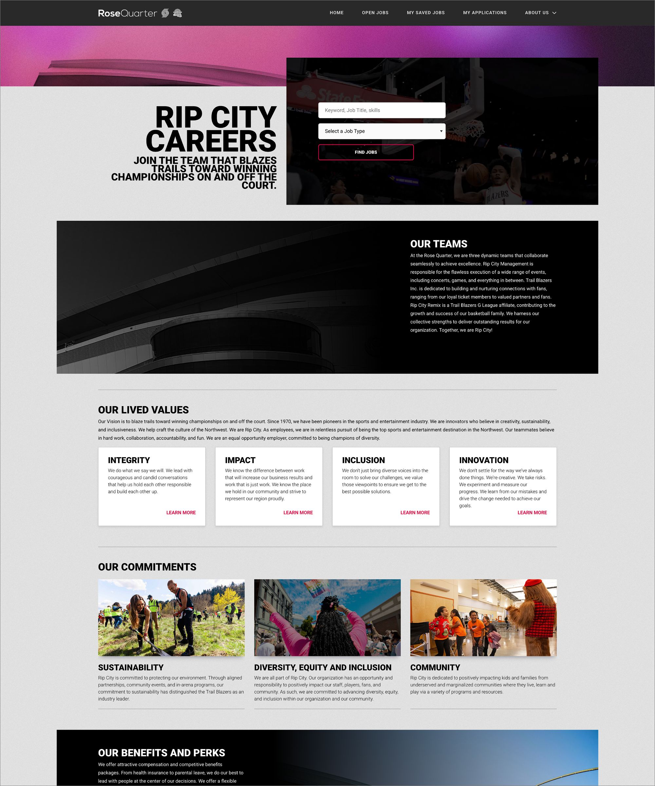

## Project Overview
<pre>
<b>Project:</b>   Rose Quarter Careers
<b>Role:</b>      UI/UX Designer & UI Developer
<b>Tools:</b>     Figma, Liquid, HTML5, CSS3, JS/jQuery, Foundation
</pre>

### Table of Contents
* [Implementation](#implementation)
* [Results](#results)
* [Figma Dev](https://www.figma.com/design/OUMCkJ2r7k9IlPnXGwrX4X/Rose-Quarter?node-id=0-1&m=dev&t=hW1KINPMBjLCwRhs-1) / [Figma Prototype](https://www.figma.com/proto/OUMCkJ2r7k9IlPnXGwrX4X/Rose-Quarter?node-id=0-1&t=hW1KINPMBjLCwRhs-1)
* [View Project](https://doylesee.github.io/rsqrtr)
 

## Implementation
I was originally supposed to build this one but another project got escalated to me, so I had to give this to another developer. I had a few extra hours one day, so I did a quick build of what it would've looked like if I had built it.

Using Figma, I quickly reviewed their corporate site to map out the styling, colors, and typography. From there, I hopped into the code to build the core layouts. There are a couple of funky things, but I tried to stay on point with their branding guide while ensuring the layout remained mobile-responsive and web-accessible.

 

## Results
This rapid Proof of Concept (POC) served as an excellent visual and technical anchor for the project. By spending those few extra hours prototyping the frontend, I was able to build a functional blueprint. The final prototype successfully demonstrated how the career site's aesthetics could work seamlessly with their corporate site while maintaining a strong foundation for responsiveness and accessibility.

Check out the [Figma design](https://www.figma.com/design/OUMCkJ2r7k9IlPnXGwrX4X/Rose-Quarter?node-id=0-1&m=dev&t=hW1KINPMBjLCwRhs-1) and [Figma Prototype](https://www.figma.com/proto/OUMCkJ2r7k9IlPnXGwrX4X/Rose-Quarter?node-id=0-1&t=hW1KINPMBjLCwRhs-1) or [view the project](https://doylesee.github.io/rsqrtr/).
